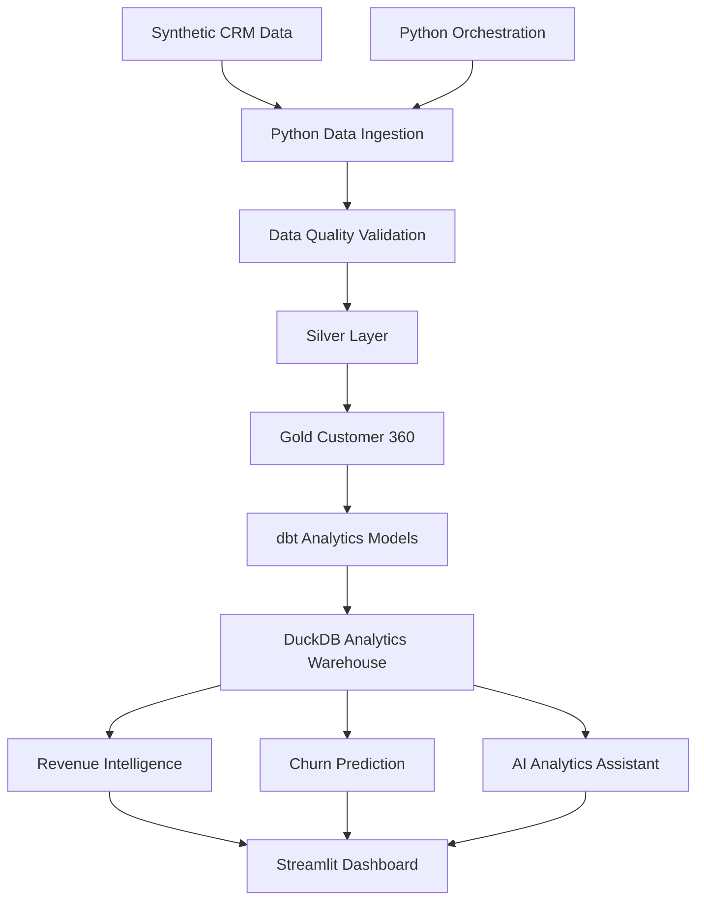

# Customer 360 & Revenue Intelligence Platform

<p align="center">
  **An End-to-End Data Engineering, Analytics & Machine Learning Project**
</p>

<p align="center">
  Python · SQL · DuckDB · dbt · Scikit-learn · Streamlit · Plotly
</p>

---

## Overview

The Customer 360 & Revenue Intelligence Platform is an end-to-end data engineering and analytics project designed to consolidate customer information into a unified analytical view.

It demonstrates how customer data can be ingested, validated, transformed and modelled to support revenue intelligence, customer segmentation, churn-risk analysis and interactive business reporting.

The platform combines Python-based data pipelines, SQL transformations, dbt models, machine learning and an interactive Streamlit application.

**Project status:** Implemented local prototype

## Business Problem

Customer, revenue and engagement information is often distributed across disconnected business systems.

This makes it difficult for organisations to:

- Build a unified view of each customer.
- Monitor revenue and customer performance.
- Understand customer segmentation and engagement.
- Identify customers who may be at risk of churn.
- Reduce manual reporting and repetitive analysis.
- Make data-driven business decisions.

This project demonstrates an integrated approach to addressing these challenges.

## Solution

The platform includes:

1. Synthetic CRM customer data generation.
2. Data ingestion and quality validation.
3. Silver and Gold data transformations.
4. A unified Customer 360 dataset.
5. Revenue and customer KPI analytics.
6. dbt-based analytical data modelling and testing.
7. Machine learning-based churn scoring.
8. A read-only, natural-language analytics assistant.
9. An interactive Streamlit dashboard.
10. An automated Python orchestration pipeline.

## Architecture



## Key Features

### 1. Data Engineering Pipeline

- Reproducible synthetic customer data generation.
- Python-based ingestion and validation.
- Data quality checks and duplicate detection.
- Silver-layer cleaning and standardisation.
- Gold-layer Customer 360 construction.
- Automated pipeline execution.

### 2. Customer 360 Analytics

- Unified customer-level dataset.
- Customer lifecycle segmentation.
- Revenue-based customer segmentation.
- Engagement analysis.
- Customer tenure and activity metrics.

### 3. Revenue Intelligence

- Revenue analysis by country.
- Revenue analysis by industry.
- Acquisition channel performance.
- Customer revenue KPIs.
- Customer-level revenue analysis.

### 4. dbt Analytics Engineering

- Staging, intermediate and mart models.
- Customer 360 dimension model.
- Customer revenue fact model.
- SQL-based transformations.
- Business-rule and data quality tests.

**Local warehouse:** DuckDB, with dbt-duckdb.

### 5. Machine Learning – Churn Prediction

- Random Forest classification pipeline.
- Numerical and categorical feature preprocessing.
- Churn probability scoring.
- High, Medium and Low risk segmentation.
- Classification metrics and ROC-AUC evaluation.

Model outputs are intended for demonstration and further experimentation, not production decision-making.

### 6. AI Analytics Assistant

- Natural-language business questions.
- Predefined analytical query templates.
- Read-only SQL execution.
- Customer, revenue and churn insights.
- Results presented through the dashboard.

The current implementation uses predefined intent matching and SQL templates rather than an external LLM.

### 7. Interactive Streamlit Dashboard

- Revenue Intelligence overview.
- Customer and revenue KPIs.
- Interactive Plotly visualisations.
- Customer Explorer.
- Churn-risk insights.
- AI Analytics Assistant interface.

## Technology Stack

| Area | Technologies |
|---|---|
| Programming | Python |
| Querying | SQL |
| Data Processing | Pandas, NumPy |
| Data Engineering | Python, ETL pipelines |
| Analytics Engineering | dbt Core, dbt-duckdb |
| Analytical Warehouse | DuckDB |
| Machine Learning | Scikit-learn, Random Forest |
| Dashboard | Streamlit |
| Visualisation | Plotly |
| Testing | Pytest, dbt tests |
| Version Control | Git, GitHub |

## Repository Structure

```text
customer-360-revenue-intelligence/
│
├── ai_assistant/
│   └── query_engine.py
│
├── analytics/
│   ├── revenue_analysis.py
│   └── verify_dbt_outputs.py
│
├── dashboard/
│   └── app.py
│
├── data/
│   ├── raw/
│   └── processed/
│
├── dbt_project/
│   ├── models/
│   │   ├── staging/
│   │   ├── intermediate/
│   │   └── marts/
│   └── tests/
│
├── ingestion/
│   ├── extract.py
│   ├── validate.py
│   ├── load.py
│   └── run_pipeline.py
│
├── machine_learning/
│   ├── train_churn_model.py
│   └── score_customers.py
│
├── transformations/
│   ├── clean_customers.py
│   ├── run_transformations.py
│   └── build_customer_360.py
│
├── orchestration/
│   └── run_all.py
│
├── tests/
│
├── docs/
├── requirements.txt
├── .env.example
├── .gitignore
└── README.md
```

## Getting Started

### Prerequisites

- Python 3.10
- Git

### 1. Clone the repository

```bash
git clone https://github.com/nithyaa-d/customer-360-revenue-intelligence.git

cd customer-360-revenue-intelligence
```

### 2. Create a virtual environment

```bash
python -m venv .venv
```

Activate on Windows:

```cmd
.venv\Scripts\activate
```

### 3. Install dependencies

```bash
python -m pip install -r requirements.txt
```

### 4. Run the complete pipeline

```bash
python -m orchestration.run_all
```

The orchestration pipeline executes data generation, ingestion, validation, transformations, Customer 360 construction, revenue analytics, dbt models and tests, churn model training and customer scoring.

### 5. Launch the dashboard

```bash
python -m streamlit run dashboard/app.py
```

### 6. Run Python tests

```bash
python -m pytest tests -v
```

## Validation and Testing

The project includes:

- Python unit tests for ingestion and data validation.
- Transformation and Customer 360 tests.
- Revenue analytics tests.
- AI assistant query and read-only execution tests.
- dbt model tests and business-rule validation.
- An end-to-end orchestration workflow.

## Data and Implementation Considerations

- The project uses reproducible synthetic customer data.
- No confidential company or customer information is included.
- Customer churn labels are derived from synthetic account-status rules.
- The churn model's evaluation results are specific to this synthetic dataset and require further validation, including checks for target leakage.
- DuckDB is used as the local analytical warehouse.
- Snowflake connectivity and production deployment are not implemented.
- The analytics assistant uses predefined SQL templates rather than unrestricted LLM-generated SQL.
- The dashboard and pipeline are local implementations, not a deployed production service.

## Future Enhancements

- Integrate real CRM data through secure APIs.
- Add incremental ingestion and change-data processing.
- Implement and validate a Snowflake warehouse deployment.
- Introduce time-based model validation and leakage-resistant churn modelling.
- Add advanced data quality monitoring.
- Extend the assistant with controlled LLM-powered analytics.
- Deploy the dashboard to a cloud environment.
- Expand CI/CD automation and model monitoring.

## Author

**Nithya Doresha**

Data Analyst | Analytics Engineer | Data Engineer

Gothenburg, Sweden

[LinkedIn](https://linkedin.com/in/nithyad2608) · [GitHub](https://github.com/nithyaa-d)

Open to opportunities across Sweden.

---

*This project demonstrates practical implementation of data engineering, analytics engineering, machine learning and business intelligence workflows using a synthetic customer dataset.*
