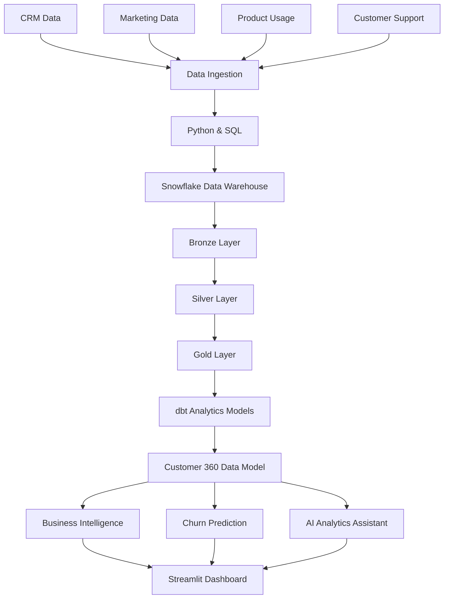

# Customer 360 & Revenue Intelligence Platform

<p align="center">
  **An End-to-End Data Engineering, Analytics & AI Project**
</p>

<p align="center">
  Python · SQL · Snowflake · dbt · Machine Learning · Streamlit · Generative AI
</p>

---

## Overview

The Customer 360 & Revenue Intelligence Platform is an end-to-end data platform designed to unify customer, CRM, sales, marketing, product usage, and support data into a single source of truth.

The platform transforms fragmented business data into actionable insights, helping organizations understand customer behaviour, monitor revenue performance, identify churn risks, and discover growth opportunities.

It combines modern data engineering practices, analytical data modelling, machine learning, and AI-powered business intelligence in one integrated solution.

**Project status:** 🚧 In development

## Business Problem

Organizations often store customer and revenue data across disconnected systems. This creates challenges such as:

- Inconsistent customer information across business systems.
- Limited visibility into the complete customer journey.
- Difficulty tracking sales pipeline and revenue performance.
- Delayed identification of customers at risk of churn.
- Manual reporting and time-consuming business analysis.
- Limited access to actionable insights for business teams.

This project addresses these challenges by building a unified and scalable analytics platform.

## Solution

The platform will:

1. Ingest data from multiple business sources.
2. Validate, clean, and transform raw datasets.
3. Build a unified Customer 360 data model.
4. Calculate customer, sales, marketing, and revenue KPIs.
5. Predict customer churn using machine learning.
6. Generate AI-powered insights using natural language queries.
7. Present business insights through interactive dashboards.

## Architecture



## Technology Stack

| Area | Technologies |
|---|---|
| Programming | Python |
| Querying | SQL |
| Data Warehouse | Snowflake |
| Data Transformation | dbt |
| Data Engineering | Python, Pandas |
| Orchestration | Apache Airflow / Prefect |
| Machine Learning | Scikit-learn |
| Generative AI | LLMs, RAG, SQL-based analytics |
| Application | Streamlit |
| Visualization | Plotly |
| Testing | Pytest, dbt tests |
| CI/CD | GitHub Actions |
| Version Control | Git, GitHub |

## Key Features

### 1. Customer 360 Analytics
- Unified customer profiles.
- Customer segmentation.
- Customer lifecycle analysis.
- Customer engagement tracking.
- Customer lifetime value analysis.

### 2. Revenue Intelligence
- Sales pipeline monitoring.
- Revenue trend analysis.
- Conversion rate tracking.
- Sales performance analysis.
- Marketing campaign effectiveness.

### 3. Data Engineering Pipeline
- Multi-source data ingestion.
- Automated transformations.
- Bronze, Silver, and Gold architecture.
- Incremental data processing.
- Data quality validation.
- Pipeline monitoring and error handling.

### 4. Predictive Analytics
- Customer churn prediction.
- Customer risk segmentation.
- Feature engineering.
- Model evaluation and explainability.
- Actionable retention insights.

### 5. AI-Powered Analytics Assistant
- Ask business questions using natural language.
- Retrieve insights from trusted analytical datasets.
- Generate SQL queries for business analysis.
- Summarize revenue and customer trends.
- Identify potential business opportunities.

### 6. Interactive Business Dashboard
- Executive KPI overview.
- Customer analytics.
- Revenue and pipeline analytics.
- Churn risk monitoring.
- Marketing performance.

## Planned Repository Structure

```text
customer-360-revenue-intelligence/
│
├── data/
│   ├── raw/
│   ├── processed/
│   └── README.md
│
├── ingestion/
│   ├── sources/
│   ├── extract.py
│   └── load.py
│
├── transformations/
│   ├── bronze/
│   ├── silver/
│   └── gold/
│
├── dbt/
│   ├── models/
│   ├── tests/
│   └── dbt_project.yml
│
├── analytics/
│   ├── customer_360/
│   ├── revenue/
│   └── marketing/
│
├── machine_learning/
│   ├── churn_prediction/
│   ├── feature_engineering/
│   └── model_evaluation/
│
├── ai_assistant/
│   ├── prompts/
│   ├── retrieval/
│   └── sql_agent/
│
├── dashboard/
│   ├── app.py
│   └── pages/
│
├── tests/
│
├── orchestration/
│
├── docs/
│   ├── architecture.md
│   └── data_dictionary.md
│
├── .github/
│   └── workflows/
│
├── requirements.txt
├── .env.example
├── .gitignore
└── README.md
```

## Project Roadmap

| Phase | Deliverable | Status |
|---|---|---|
| 1 | Repository and documentation | 🟡 In progress |
| 2 | Dataset preparation and source ingestion | ⬜ Planned |
| 3 | Data warehouse and modelling | ⬜ Planned |
| 4 | Data quality and pipeline automation | ⬜ Planned |
| 5 | Customer 360 and revenue analytics | ⬜ Planned |
| 6 | Churn prediction model | ⬜ Planned |
| 7 | AI-powered analytics assistant | ⬜ Planned |
| 8 | Streamlit dashboard | ⬜ Planned |
| 9 | Testing, CI/CD and deployment | ⬜ Planned |

## Data Strategy

The project will use publicly available or synthetically generated datasets.

No confidential company, customer, or employer data will be used.

The initial datasets will represent:

- Customer profiles
- CRM opportunities
- Sales transactions
- Marketing campaigns
- Product usage events
- Customer support interactions

## Getting Started

The implementation instructions will be added as each component is developed.

### Prerequisites

- Python 3.11+
- Git
- Snowflake account (for the warehouse implementation)
- dbt
- Streamlit

## Project Goals

The objective is to demonstrate practical experience in:

- Designing end-to-end data pipelines.
- Building analytical data warehouses.
- Developing scalable data models.
- Implementing data quality frameworks.
- Applying machine learning to business problems.
- Integrating LLM-powered analytics.
- Delivering production-style data applications.

## Author

**Nithya Doresha**

Data Analyst | Analytics Engineer | Data Engineer

Gothenburg, Sweden

[LinkedIn](https://linkedin.com/in/nithyad2608) · [GitHub](https://github.com/nithyaa-d)

---

*This project is being developed as a practical demonstration of modern data engineering, analytics, and AI capabilities.*
